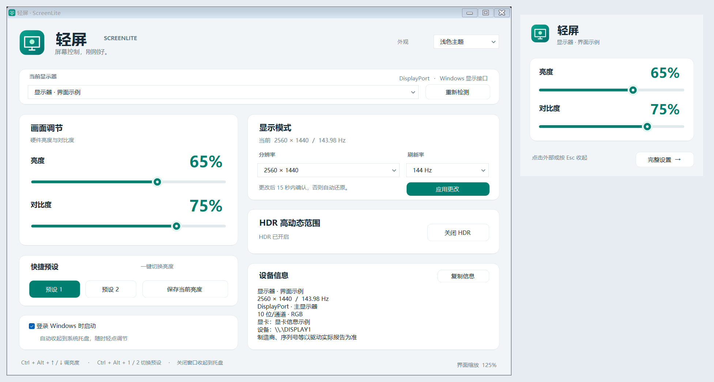
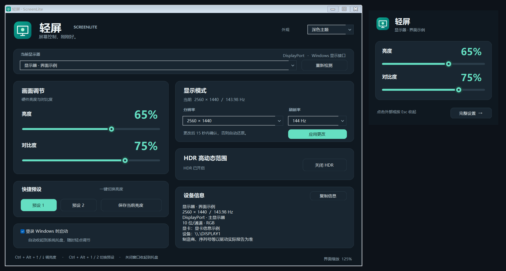

# 轻屏 ScreenLite

轻量、中文、便携的 Windows 显示器控制工具。托盘一键调节硬件亮度与对比度，在完整设置中管理 HDR、分辨率和刷新率。



## 下载使用

[下载 Windows 便携版 v1.4.0](releases/ScreenLite-v1.4.0-Windows.zip)

解压整个文件夹后运行 `ScreenLite.exe`。升级前先右键托盘图标退出旧版，再覆盖完整文件夹；**务必保留 `ScreenLite.exe.config`，原生高 DPI 配置在此文件中**。

系统要求：Windows 10/11、.NET Framework 4.8。逐屏 DPI 适配需要 Windows 10 1703 或更新版本。没有额外大型运行时、安装器或管理员权限要求。

## 功能

- 系统托盘常驻；点击图标弹出快速亮度、对比度调节，点击外部或 Esc 收起。
- 外接显示器使用 DDC/CI 硬件控制；内屏亮度使用 WMI。检测不到支持的功能会禁用，不使用遮罩或 Gamma 变暗。
- 完整设置中提供每个可可靠识别设备的 HDR 开关、系统枚举的分辨率/刷新率组合，以及设备信息。
- HDR 和显示模式更改需要在 15 秒内确认，否则尝试恢复原设置。
- 两个可保存的亮度预设，全局快捷键，可选登录启动。
- 浅色/深色主题、矢量绘制图标、PerMonitorV2 原生高 DPI 适配。
- 无网络请求、常驻动画或后台硬件轮询。只在检测和用户操作时访问硬件。



## 快捷键

| 快捷键 | 当前所选设备 |
| --- | --- |
| Ctrl + Alt + ↑ / ↓ | 亮度 ±5 个百分点 |
| Ctrl + Alt + 1 / 2 | 应用亮度预设 |

选择显示器、保存预设及其他设置请进入完整设置。快速面板仅保留亮度、对比度和完整设置入口。

## 编译

无需 NuGet 包，使用 Windows .NET Framework 自带 C# 编译器：

```powershell
powershell -NoProfile -ExecutionPolicy Bypass -File .\build.ps1
```

生成 `ScreenLite.exe`，与 `ScreenLite.exe.config` 一起使用。源码按硬件控制、显示配置、界面与外观分文件组织；图标包含可编辑 SVG 与 ICO。

## 测试

先退出运行中的轻屏，避免全局快捷键冲突：

```powershell
powershell -NoProfile -ExecutionPolicy Bypass -File .\test.ps1
```

测试覆盖显示模式预览/保存/还原、错误处理、分辨率与刷新率配对、硬件能力禁用、小面板，以及 DPI 上下文与模拟缩放通知。测试短暂显示窗口，**不改真实显示器的 HDR、分辨率或刷新率**。

已在实际 125% 缩放环境验证原生 DPI 和布局，并模拟 150%、200%、100% 的 DPI 消息检查布局回归。模拟消息不能替代多显示器实机兼容性验证。当前版本由使用者反馈常用功能可用；不据此宣称兼容所有硬件或保证特定 CPU/内存指标。

## 硬件与驱动限制

DDC/CI 需要在显示器菜单中开启。HDR、复制显示、扩展坞、转接器、KVM、USB 显卡、驱动和远程桌面可能限制功能。只在设备身份能可靠对应时开放 Windows 显示设置；复制屏幕共享显示源时禁用独立模式/HDR 更改。

自动还原依赖程序与驱动正常响应；强行结束进程或驱动卡死时不能保证倒计时执行。设备断开或驱动拒绝还原时会报告错误。不要在预览期间插拔显示器。

刷新率是 Hz，不是游戏帧率。选项通常为驱动报告的整数 Hz，信息区可显示信号路径报告的小数 Hz。无自定义时序、VRR、G-SYNC 或 FreeSync 开关。

可执行文件未签名。详细说明、数据保存位置、移除方式和接口依据见 [使用说明](使用说明.md)。

## 许可

当前未指定开源许可证；公开仓库用于展示、下载和查看源码。若要将源码用于其他项目或重新分发，请先与仓库作者确认许可。
